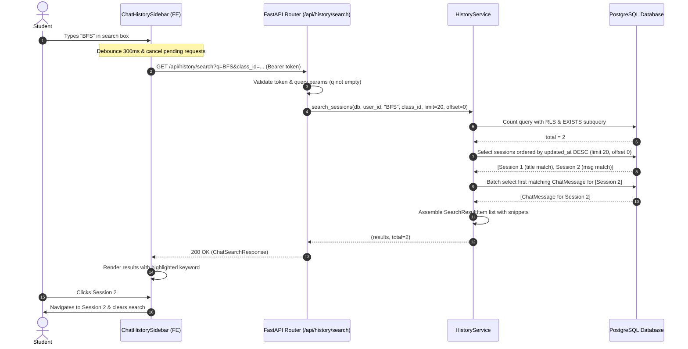

# AI-101 — Search Chat History (API Design)

> **Ticket:** [AI-101](https://ai03.atlassian.net/browse/AI-101) (Epic AI-93: Chat History & Memory) · **Priority:** Medium · **Story Points:** 5 SP  
> **Assignee:** Bui Trong Suu  
> **Status:** Design  
> **Target Branch:** `main`  
> **Related Stories:** AI-95 (Chat History & Sidebar UI), AI-97 (Reopen an Old Conversation), AI-99 (Delete a Chat Session), AI-63 (Contextual Follow-up Questions).

---

## 1. Purpose

Allow an authenticated student to search their saved chat history by keyword. The search matches both the conversation title (`ChatSession.title`) and individual message contents (`ChatMessage.content`). Results are strictly scoped to the authenticated user (Row-Level Security) and return relevant snippets with match context to power frontend keyword highlighting and navigation.

### Acceptance Criteria (Jira AI-101)

* **AC-01:** The system provides keyword search across both session titles and message contents, returning all matching sessions sorted newest first.
* **AC-02:** Strict Row-Level Security (RLS) is enforced: only sessions owned by the authenticated caller (`user_id == current_user.id`) are returned. Sessions belonging to other users are never returned under any circumstance.
* **AC-03:** Results include a preview snippet highlighting the match context:
  * If matched by title: returns title preview with `match_in='title'`.
  * If matched by message: returns the excerpt around the keyword with `match_in='message'`.
  * If query yields no matches: returns an empty list (`items: []`, `total: 0`) without error.
  * Clicking any result navigates to that conversation in the chat interface.

---

## 2. API Contract

### 2.1 Request

* **Method:** `GET`
* **URL:** `/api/history/search`
* **Auth:** `Authorization: Bearer <JWT_ACCESS_TOKEN>`
* **Request Body:** None

#### Query Parameters

| Parameter | Type | Required | Default | Validation / Constraint | Description |
|---|:---:|:---:|:---:|---|---|
| `q` | `string` | **Yes** | — | `min_length=1`, `max_length=200`, `pattern=r"\S"` | Search keyword. Must contain at least one non-whitespace character. |
| `class_id` | `UUID` | No | `None` | Valid UUIDv4 | Optional class filter to restrict search to a specific course class. |
| `limit` | `integer` | No | `20` | `ge=1`, `le=50` | Maximum number of search result items to return per page. |
| `offset` | `integer` | No | `0` | `ge=0` | Number of items to skip for pagination. |

> **⚠️ Router Ordering Rule:**  
> The endpoint `GET /api/history/search` **must** be declared before `GET /api/history/{session_id}` in `app/routers/history/router.py`. Otherwise, FastAPI's path routing will interpret the literal string `"search"` as a `session_id` UUID parameter and immediately return `422 Unprocessable Entity`.

---

### 2.2 Success Response

**Status Code:** `200 OK`  
**Pydantic Schema:** `ChatSearchResponse`

```json
{
  "items": [
    {
      "session_id": "a2c3d4e5-f6a7-48b9-80c1-d2e3f4a5b6c7",
      "title": "Thuật toán tìm kiếm theo chiều rộng BFS",
      "updated_at": "2026-10-25T14:30:00Z",
      "snippet": "Thuật toán tìm kiếm theo chiều rộng BFS",
      "match_in": "title"
    },
    {
      "session_id": "b3c4d5e6-f7a8-49c0-91d2-e3f4a5b6c7d8",
      "title": "Giải thuật đồ thị cơ bản",
      "updated_at": "2026-10-24T09:15:22Z",
      "snippet": "...cho biết sự khác biệt giữa thuật toán BFS và DFS trong việc tìm đường đi ngắn nhất...",
      "match_in": "message"
    }
  ],
  "total": 2,
  "query": "BFS"
}
```

#### Response Fields

| Field | Type | Description |
|---|---|---|
| `items` | `List[SearchResultItem]` | List of matching session summaries for current page. |
| `items[].session_id` | `UUID` | Unique identifier of the chat session. |
| `items[].title` | `string \| null` | Title of the conversation session. |
| `items[].updated_at` | `ISO 8601 string` | Timestamp when the session was last updated. |
| `items[].snippet` | `string` | Excerpt of text containing or representing the match. |
| `items[].match_in` | `Literal["title", "message"]` | Source of the match: `"title"` if matched in session title, `"message"` if matched in message body. |
| `total` | `integer` | Total number of matching sessions across all pages. |
| `query` | `string` | The sanitized query keyword that was executed. |

---

### 2.3 Error Responses

| Status Code | Condition | Response Body Example |
|---|---|---|
| `401 Unauthorized` | Missing, expired, or invalid Bearer token | `{"detail": "Not authenticated."}` |
| `422 Unprocessable Entity` | Parameter `q` is missing, empty string, or whitespace only (`"   "`) | `{"detail": [{"loc": ["query", "q"], "msg": "String should match pattern...", "type": "string_pattern_mismatch"}]}` |
| `422 Unprocessable Entity` | Parameter `class_id` is not a valid UUID | `{"detail": [{"loc": ["query", "class_id"], "msg": "Input should be a valid UUID...", "type": "uuid_parsing"}]}` |

---

## 3. Technical Architecture & Search Strategy

```
User enters keyword in Sidebar
          │
          ▼ (debounce 300ms)
GET /api/history/search?q=BFS&class_id=...
          │
          ▼
FastAPI Router: validate query param `q` (strip, min 1, max 200, non-whitespace)
          │
          ▼
history_service.search_sessions(db, user_id, query, class_id, limit, offset)
          │
          ├─ 1. Escape SQL LIKE wildcards: '%', '_', '\'
          ├─ 2. Build base query with RLS: ChatSession.user_id == user_id
          │     AND (ChatSession.title ILIKE '%escaped_query%'
          │          OR EXISTS (SELECT 1 FROM ChatMessage WHERE ... content ILIKE '%escaped_query%'))
          │
          ├─ 3. Count total matching sessions (SQL COUNT on base subquery)
          ├─ 4. Query page of ChatSession (order by updated_at DESC, limit, offset)
          │
          ├─ 5. Batch fetch matching ChatMessages for sessions without title match (in_ clause)
          ├─ 6. Build SearchResultItem list with extracted snippets
          │
          ▼
Return ChatSearchResponse(items, total, query)
```

### 3.1 Row-Level Security (RLS Boundary)

Data isolation is guaranteed at the SQL level. The base query begins with:

```python
base = select(ChatSession).where(
    ChatSession.user_id == user_id,
    or_(
        ChatSession.title.ilike(keyword, escape="\\"),
        message_match,
    ),
)
```

Even if a student specifies a `class_id` shared with other classmates, the database engine filters out any session whose `user_id != current_user.id`. A user can never read, inspect, or discover sessions belonging to other students or instructors.

### 3.2 SQL LIKE Wildcard Escaping

When accepting arbitrary user input for SQL `ILIKE`, special wildcard characters (`%`, `_`, `\`) must be escaped. If left unescaped, an input of `%` would match every message in the user's database:

```python
def _escape_like(value: str) -> str:
    """Escape LIKE wildcards so user input is treated as literal characters."""
    return value.replace("\\", "\\\\").replace("%", "\\%").replace("_", "\\_")
```

The keyword pattern is then constructed as `f"%{_escape_like(query)}%"` and passed with `escape="\\"`.

### 3.3 Duplicate Elimination via `EXISTS` Subquery

A single chat conversation can contain dozens of messages mentioning the search keyword. Joining `ChatSession` directly to `ChatMessage` creates duplicate session rows that require memory-heavy deduplication. Instead, the service utilizes an SQL `EXISTS` subquery:

```python
message_match = exists().where(
    ChatMessage.session_id == ChatSession.id,
    ChatMessage.content.ilike(keyword, escape="\\"),
)
```

This guarantees:
1. Each matching session is evaluated exactly once by the database engine.
2. `COUNT(*)` over the subquery returns the exact number of matching conversations without duplicate inflation.

### 3.4 Eliminating N+1 Query via Batch Message Retrieval

For sessions that match by message content rather than title, an excerpt must be extracted. Querying each session's messages individually would cause an N+1 query vulnerability. The service collects all matching session IDs on the current page and executes a single batched query:

```python
matching_messages = db.scalars(
    select(ChatMessage)
    .where(
        ChatMessage.session_id.in_(session_ids),
        ChatMessage.content.ilike(keyword, escape="\\"),
    )
    .order_by(ChatMessage.session_id, ChatMessage.created_at.asc())
).all()
```

The service indexes the first matching message per session in a hash map `first_message_by_session: dict[uuid.UUID, ChatMessage]`, maintaining `O(1)` access during result serialization.

### 3.5 Snippet Extraction & Priority

* **Priority:** If a session matches in both title and message body, title match takes priority (`match_in='title'`), keeping UI titles crisp.
* **Extraction:** For message matches, `_extract_snippet(content, query, context_chars=100)` locates the case-insensitive keyword index, takes 50 characters before and after, and prepends/appends `"..."` if truncated.

### 3.6 Performance & Indexing Considerations

* **Current Implementation:** Uses PostgreSQL `ILIKE '%keyword%'`. For expected student history sizes (< 100 sessions per semester), execution takes < 5ms.
* **High-Volume Scale Plan:** For large enterprise datasets (> 100,000 messages), leading wildcard queries cannot use standard B-Tree indexes. When scaling, a trigram GIN index (`pg_trgm`) should be applied:
  ```sql
  CREATE EXTENSION IF NOT EXISTS pg_trgm;
  CREATE INDEX IF NOT EXISTS idx_chat_message_content_trgm ON chat_message USING gin (content gin_trgm_ops);
  CREATE INDEX IF NOT EXISTS idx_chat_session_title_trgm ON chat_session USING gin (title gin_trgm_ops);
  ```
* **No LLM / Vector overhead:** Pure relational SQL search with zero API tokens or latency from Qdrant/Gemini.

---

## 4. Sequence Diagram



---

## 5. Automated Backend Test Plan

The implementation will be covered by 11 comprehensive test cases in `tests/test_history.py`, utilizing existing fixtures (`client`, `db_session`, `_login`):

| # | Test Function Name | AC | Description & Assertions |
|:---:|---|:---:|---|
| 1 | `test_search_by_title_returns_matching_sessions` | AC-01 | Keyword in session title returns session with `match_in='title'` and snippet. |
| 2 | `test_search_by_message_content_returns_matching_sessions` | AC-01, AC-03 | Keyword in message content returns session with `match_in='message'` and context snippet. |
| 3 | `test_search_does_not_return_other_users_sessions` | AC-02 | User B cannot find User A's session even if keyword matches. Returns `items=[]`, `total=0`. |
| 4 | `test_search_with_no_match_returns_empty_list` | AC-03 | Non-existent keyword returns HTTP 200 with `items=[]` and `total=0`. |
| 5 | `test_search_is_case_insensitive` | AC-01 | Query `"THUATTOAN"` matches session titled `"thuatToan"`. |
| 6 | `test_search_with_empty_q_returns_422` | Validation | Empty query `q=""` or whitespace `q="   "` returns HTTP 422. |
| 7 | `test_search_requires_authentication` | Security | Unauthenticated call without Bearer token returns HTTP 401. |
| 8 | `test_search_respects_class_id_filter` | AC-01 | Providing an unrelated `class_id` restricts results and returns empty list. |
| 9 | `test_search_pagination_returns_total_and_slices` | AC-01 | When 3 sessions match, `limit=2, offset=0` returns 2 items with `total=3`; next page returns 1 item. |
| 10 | `test_search_escapes_like_wildcards` | Security | Searching for literal `"%"` only matches session titled `"100% done"`, not all sessions. |
| 11 | `test_search_title_match_takes_priority_over_message` | AC-01, AC-03 | When a session matches both title and message, `match_in` is marked as `"title"`. |
