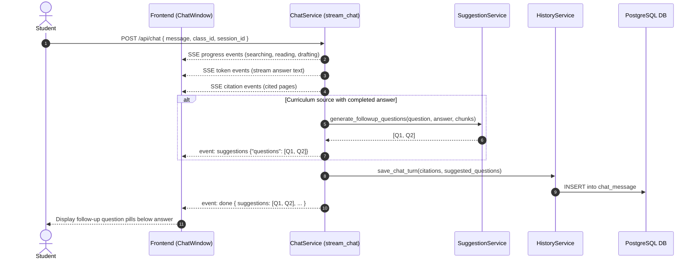

# AI-125 — Suggested Follow-up Questions

> **Ticket:** [AI-125](https://ai03.atlassian.net/browse/AI-125) (Epic AI-57: Contextual Q&A) · **Priority:** Medium
>
> **Assignee:** Le Van An
>
> **Status:** Implemented
>
> **Related stories:** AI-61 (RAG Q&A Backend), AI-63 (Contextual Follow-up Questions), AI-95 (Chat History & Sidebar UI), AI-97 (Reopen Conversation).

---

## 1. Purpose

After receiving an answer grounded in course materials (`source = curriculum`), students and trainers can explore the course deeper without having to formulate their next prompts manually.

When a chat turn completes, the backend uses the student's question, the LLM's completed response, and the retrieved course materials to generate **2–3 suggested follow-up questions**. Initial access to an empty chat does not generate questions; suggestions are generated strictly after a conversation turn has an answer.

---

## 2. Acceptance Criteria Mapping

| ID | Acceptance Criteria | Backend Implementation |
|---|---|---|
| **AC-01** | After a completed answer grounded in class materials, the chat displays 2–3 suggested follow-up questions related to the student's question, the answer, and the retrieved lesson context. | `suggestion_service.generate_followup_questions()` creates 2–3 questions using `suggest-questions-prompt`, emitted via SSE `event: suggestions` and attached to `event: done`. |
| **AC-02** | Suggestions use the same language as the student's question and are answerable from the current class's approved materials. | The prompt enforces matching the query's language and restricts answers strictly to the retrieved course chunks. |
| **AC-03** | Suggestions are not shown when there is not enough relevant class context to support useful follow-up questions. | Context length check (`MIN_CONTEXT_LENGTH = 20`) and prompt instructions return `[]` if context is insufficient or if fewer than 2 quality questions can be formulated. No `suggestions` event is emitted. |
| **AC-04** | Selecting a suggestion sends it as a new message in the same conversation and class, using the normal authentication, retrieval, answer, and citation flow. | Suggestions are submitted as standard `POST /api/chat` requests containing the active `session_id` and `class_id`, routed through normal authentication, condensation, retrieval, and citation. |
| **AC-05** | Showing suggestions does not change the completed answer or its citations, and suggestions are hidden while the answer is still processing or has failed. | Suggestions are generated and streamed only after answer tokens and citations are fully emitted. Any generation failure or timeout safely returns `[]` without raising errors or altering the answer stream. |

---

## 3. Architecture & Follow-up Flow



---

## 4. API & Event Contracts

### SSE Stream Events (`POST /api/chat`)

1. `event: progress` — Current stage indicator (`searching`, `reading`, `drafting`).
2. `event: token` — Chunks of the answer text streamed from LLM.
3. `event: citation` — Cited course documents.
4. `event: suggestions` (AI-125):
   ```
   event: suggestions
   data: {"questions": ["How does backpropagation update weights?", "Why use ReLU activation?"]}
   ```
5. `event: done` — Turn completion metadata:
   ```json
   {
     "source": "curriculum",
     "used_web_search": false,
     "threshold": 0.8,
     "top_score": 0.91,
     "session_id": "7c9e6679-7425-40de-944b-e07fc1f90ae7",
     "user_message_id": "...",
     "assistant_message_id": "...",
     "suggestions": [
       "How does backpropagation update weights?",
       "Why use ReLU activation?"
     ],
     "suggested_questions": [
       "How does backpropagation update weights?",
       "Why use ReLU activation?"
     ]
   }
   ```

---

## 5. Persistence & History Reload

* Database table: `chat_message`
* Column: `suggested_questions JSON NULL` (Alembic migration `0020_chat_suggested_questions`)
* Schema: `ChatMessageResponse.suggested_questions: list[str] = Field(default_factory=list)`
* When opening previous sessions (`GET /api/history/{session_id}`), past suggested questions are preserved and returned with each message.

---

## 6. Verification & Automated Tests

* `tests/services/chat/test_suggestion_service.py`: Unit tests covering JSON parsing, markdown block cleaning, context length thresholds, and LLM failure fallbacks.
* `tests/services/chat/test_chat_service.py`: Integration tests verifying SSE events (`suggestions`, `done`) and ensuring non-curriculum queries omit suggestions.
* `tests/test_history.py`: Verifies database persistence and round-trip reloading through history APIs.
