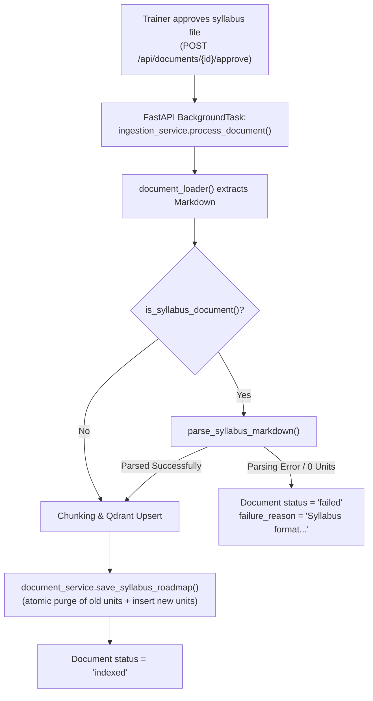

# AI-133 — Parse Course Units & Topic Outline from Syllabus Markdown

> **Ticket:** AI-133 · **Status:** Implemented (backend)
> **Branch:** `features/Implementation_CourseSyllabusRoadmap` · **Companion UI design:**
> `course-qa-agent-fe/docs/design/ai-133-syllabus-roadmap.md`

## Purpose

When a course syllabus file (`.xlsx`, `.xls`, or `.md`) is ingested and approved, the platform automatically parses the course chapters, unit numbers, unit titles, topic outline, and detailed session content into structured database records. 

Enrolled trainees and trainers can then view a structured, expandable syllabus roadmap directly on their class workspace page without manual data entry by the course staff.

## Scope and confirmed team decisions

- **Zero Manual Data Entry (AC-01):** Syllabus parsing runs automatically during the background document ingestion pipeline (post-approval in AI-55).
- **Sequential Unit Extraction (AC-02, AC-03):** Units are extracted sequentially (`unit_number` starting from 1) preserving original ordering and outline hierarchy from `# Training Schedule` and `## Topic Outline`.
- **Fail-Fast Format Error Handling (AC-04):** If an uploaded syllabus file cannot be recognized or produces no valid units, ingestion marks the document as `failed` with `failure_reason = "Syllabus format is not recognized or contains no course units."` allowing trainer review and retry instead of silently publishing an empty roadmap.
- **Clean Idempotent Replacement (AC-05):** Re-uploading or updating an approved syllabus document for the same class completely replaces previous syllabus units in a single transaction, leaving no stale or duplicated rows.
- **Class-Scoped RBAC & Isolation (AC-06):** A class's syllabus roadmap is accessible only to active members of that class (students, teaching assistants, assigned trainers, and admins). Cross-class data access returns `403 Forbidden`.
- **XSS & Content Sanitization (AC-07):** All outline content is sanitized to strip dangerous HTML tags (`<script>`, `<iframe>`, `javascript:` URI schemes, and inline event handlers) while preserving valid Markdown styling (bold, lists, session headers, and clean links).
- **Excel Loader Hardening:** Automatically ignores hidden/system validation sheets (e.g., `DV-IDENTITY-0`) and filters out broken Excel formula error codes (`#REF!`, `#VALUE!`).

## Data model

```text
syllabus_unit
  id             UUID PK
  class_id       UUID FK class.id       ON DELETE CASCADE
  document_id    UUID FK document.id    ON DELETE CASCADE
  unit_number    INTEGER NOT NULL
  unit_title     VARCHAR(255) NOT NULL
  description    TEXT NULL              (e.g., "2 sessions · OS1")
  content        TEXT NOT NULL          (clean Markdown session breakdown)
  topic_outline  TEXT NULL              (high-level overview extracted from Section 7)
  created_at     TIMESTAMPTZ DEFAULT now()
  UNIQUE (class_id, unit_number)
```

Migration `0015_syllabus_roadmap` (down_revision `0014_class_prerequisite`) adds the `syllabus_unit` table with indexes on `class_id` and `document_id`.

## Ingestion flow & lifecycle



## API design

| Method and path | Auth | Purpose |
|---|---|---|
| `GET /api/student/classes/{class_id}/syllabus` | Enrolled Student / Class Staff / Admin | Retrieve the active structured syllabus roadmap and units for the class. |

### Response payload contract

`GET /api/student/classes/c1f7b8.../syllabus`

```json
{
  "class_id": "c1f7b80a-9d2e-4b21-82ab-521b4a3901b2",
  "document_id": "d2a3c415-e21b-439f-a82f-8716b5394121",
  "file_name": "02-rag-and-optimization-Syllabus-ver1.1.xlsx",
  "topic_outline": "Unit 01: Tokenization, Quantization, Advanced Indexing\nUnit 02: Hybrid Search\nUnit 03: Query Transformation",
  "units": [
    {
      "id": "e93ab123-1122-3344-5566-778899aabbcc",
      "unit_number": 1,
      "unit_title": "Advanced Indexing",
      "description": "2 sessions · OS1",
      "content": "### Session 1\n- **Concept/Lecture** (180 min · Self Learning · OS1)\n  - Tokenization: Revise tokenization and usecases\n  - Quantization: Core concept and Algorithms\n- **Test/Quiz**: Quiz (30 min · Offline · OS1)\n\n### Session 2\n- **Assignment/Lab**: Lab: Build Semantic Chunker & HNSW Vector DB (150 min · Offline · OS1)"
    },
    {
      "id": "f04bc234-2233-4455-6677-8899aabbccdd",
      "unit_number": 2,
      "unit_title": "Hybrid Search",
      "description": "2 sessions · OS2",
      "content": "### Session 3\n- **Concept/Lecture** (180 min · Self Learning · OS2)\n..."
    }
  ]
}
```

*Note:* If the class has no indexed syllabus document yet, the API returns HTTP 200 with `document_id: null`, `topic_outline: null`, and `units: []`.

## Errors

| Status | When |
|---|---|
| `401` | Missing or invalid Bearer token. |
| `403` | Caller is not an enrolled active student, class trainer, co-trainer, or admin (`You are not a member of this class.`). |
| `404` | Class not found or archived for non-admin callers. |

## Backend responsibilities

- `app/models/document.py` — `SyllabusUnit` SQLAlchemy entity and `Document.syllabus_units` relationship.
- `alembic/versions/0015_syllabus_roadmap.py` — Schema migration for `syllabus_unit`.
- `app/services/ingestion/syllabus_parser.py` — Syllabus detection, Markdown table/heading parsing, session formatting, HTML sanitization, and `SyllabusFormatError`.
- `app/services/ingestion/loader/excel_loader.py` — Skip hidden sheets and sanitize Excel formula error tokens.
- `app/services/ingestion_service.py` — Hook syllabus parsing into background ingestion lifecycle and map format errors to UI failure reasons.
- `app/services/document_service.py` — `save_syllabus_roadmap` (atomic replacement) and `get_class_syllabus_roadmap`.
- `app/routers/student/router.py` — `GET /api/student/classes/{class_id}/syllabus` endpoint and Pydantic response models (`ClassSyllabusRoadmapRead`, `SyllabusUnitRead`).

## Edge cases

- **Corrupted / Incomplete Excel Structure:** If the file contains no readable course units under `# Training Schedule` or headings, it fails fast before embedding chunks into Qdrant.
- **Same-Class Re-upload:** When a new syllabus version is approved and indexed, all existing units for that class are purged and replaced in a single database transaction.
- **Document Deletion:** Deleting an indexed syllabus document via `DELETE /api/documents/{id}` cascades to delete its associated `SyllabusUnit` records.
- **XSS Protection:** Content containing malicious tags like `<script>alert(1)</script>` or `javascript:` links are sanitized before persistence.

## Test coverage

- `tests/services/ingestion/test_syllabus_parser.py`: Detection logic, extraction from sample `.xlsx` fixture and pure Markdown, XSS sanitization, format error raising.
- `tests/services/ingestion/loader/test_excel_loader.py`: Verifies hidden sheets (`DV-IDENTITY-0`) and formula error codes (`#REF!`, `#VALUE!`) are properly ignored.
- `tests/test_syllabus_roadmap.py`: End-to-end ingestion pipeline lifecycle, replacement on re-upload, class member access control, and 403 authorization gates.

Run the test suite:

```bash
uv run pytest tests/services/ingestion/test_syllabus_parser.py tests/test_syllabus_roadmap.py tests/services/ingestion/loader/test_excel_loader.py -v
uv run ruff check app/ tests/
```

## Acceptance Criteria Mapping

| Jira AC | Implementation Details | Status |
|---|---|:---:|
| **AC-01** | Automatically extracts unit number, title, and outline content upon ingestion completion | **Implemented** |
| **AC-02** | Class page shows structured, sequential units expandable to session outlines | **Implemented** |
| **AC-03** | Preserves order and hierarchy as written in source schedule | **Implemented** |
| **AC-04** | Malformed syllabus flagged as `failed` with actionable retry reason (AI-55 aligned) | **Implemented** |
| **AC-05** | Re-upload replaces previous units cleanly without duplication | **Implemented** |
| **AC-06** | Class-scoped access control; no leakage between classes (`403 Forbidden`) | **Implemented** |
| **AC-07** | Markdown content sanitized against script/HTML execution | **Implemented** |

