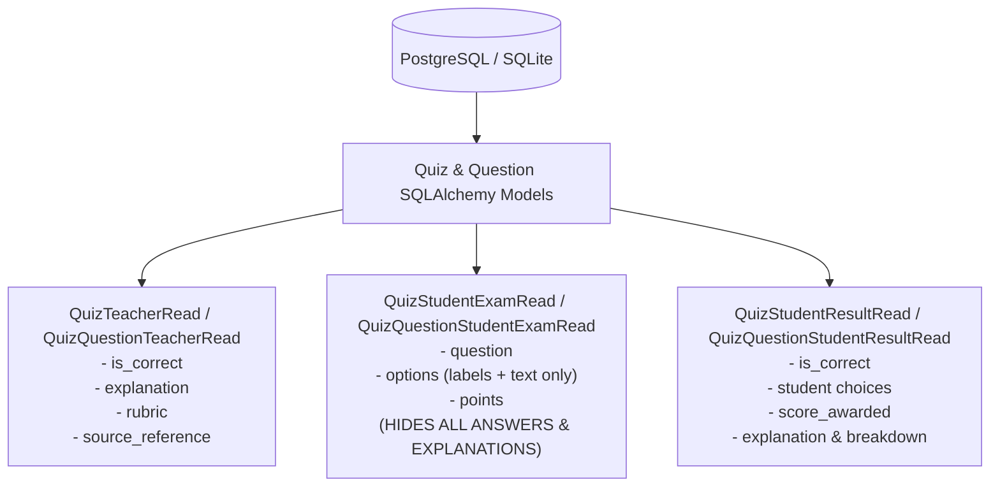

# AI-148 — Quiz Schema and Excel Template Contract

> **Ticket:** [AI-148](https://ai03.atlassian.net/browse/AI-148) (Epic AI-147: Quiz Generation & Assessment) | **Priority:** Medium | **Story Points:** 5 SP  
> **Assignee:** Le Van An (`levanannt79@gmail.com`)  
> **Status:** Implemented / Ready for Review  
> **Target Branch:** `features/Implementation_QuizSchemaExcelContract`  
> **Related Stories:** AI-149 (generate quiz from documents), AI-150 (validate generated questions), AI-151 (teacher review & export to Excel), AI-152 (import quiz from teacher Excel), AI-153 (student quiz-taking), AI-154 (auto-grade quiz), AI-159 (skill taxonomy & 5-level rubrics), AI-160 (question bank).

> [!NOTE]
> **Evolution Note (AI-159 & 0041_skill_taxonomy):**
> In subsequent development, the question difficulty taxonomy has been extended from the 3-level Bloom model (`REMEMBER`, `UNDERSTAND`, `APPLY`) to the **5-level Dreyfus Skill Taxonomy** (`NOVICE`, `BEGINNER`, `COMPETENT`, `PROFICIENT`, `MASTER`). Furthermore, `quiz_question` now supports an optional `skill_id` foreign key referencing class-scoped competencies in the `skill` table. See [`ai-159-skill-taxonomy-rubrics.md`](./ai-159-skill-taxonomy-rubrics.md) for full details.

---

## 1. Purpose and Scope

Establish the single source of truth for the **persistence layer, API data transfer objects (DTOs), grading engine, and Excel template contract** across the Quiz Generation & Assessment subsystem. 

Because multiple companion tasks depend directly on this contract (AI-149 produces questions matching this schema, AI-151 exports to this format, AI-152 validates imports using this contract, AI-153 presents student exam views, and AI-154 grades attempts), this story provides:
1. **Relational Data Model & Alembic Migration**: 5 core database tables (`quiz`, `quiz_question`, `quiz_option`, `quiz_attempt`, `quiz_answer`) with SQLite & PostgreSQL compatible constraints.
2. **Security-Separated DTOs**: Strict Pydantic models preventing answer leakage during ongoing student exam sessions.
3. **Partial Credit with Penalty Grading Engine**: Pedagogically sound scoring for multiple-choice questions with negative penalty support and configurable thresholds.
4. **Excel Template Contract & Strict Validator**: Fixed-column template supporting up to 6 choices (A through F), Bloom's taxonomy difficulty, strict row-by-row error reporting, and verified **No Schema Drift** on roundtrip export/import.

### Acceptance Criteria (Jira AI-148)

* **AC-01**: Quiz, question, option, attempt, answer, and grading fields are defined.
* **AC-02**: The Excel template covers question type, question, options, correct answer(s), difficulty, explanation, rubric, and source.
* **AC-03**: An exported template can be re-imported without schema drift.
* **AC-04**: A sample template and validation rules are documented.

---

## 2. Key Technical Decisions & Rationale

| # | Decision | Why |
|---|---|---|
| **D1** | **3 Supported Question Types**: `SINGLE_CHOICE`, `MULTIPLE_CHOICE`, and `FILL_IN_BLANK`. | Covers objective knowledge evaluation without requiring unstructured NLP essay grading in this iteration. |
| **D2** | **Bloom's Cognitive Taxonomy Levels**: `REMEMBER`, `UNDERSTAND`, and `APPLY`. | Replaces vague labels (Easy/Medium/Hard) with measurable pedagogical standards required for academic course roadmaps. |
| **D3** | **Prompt field renamed to `question`**. | Aligns naming with domain terminology across frontend, backend, and Excel headers. |
| **D4** | **Controlled Option B Excel Layout (Fixed A $\rightarrow$ F)**. | Columns `Option A` through `Option F` are explicit. Options A and B are mandatory for choice questions; C through F are optional but must be sequential. Fill-in-the-blank questions leave options blank. Avoids messy delimiters inside a single cell while capping complexity at 6 choices. |
| **D5** | **Partial Credit with Penalty Algorithm for Multiple-Choice**. | If a question has $k$ correct answers, each correct choice grants $+1/k$ and each wrong choice penalizes $-1/k$. Points can be negative by default (`allow_negative=True`) to prevent students from guessing all choices. Extensible via `grading_config` JSON. |
| **D6** | **Security Separation in Pydantic Schemas**. | `QuizQuestionStudentExamRead` hides `is_correct`, `explanation`, `rubric`, and `source_reference` during active exams. Only after attempt submission does `QuizQuestionStudentResultRead` reveal solutions and breakdowns. |
| **D7** | **Zero Schema Drift Roundtrip Contract**. | Questions exported to Excel via `export_quiz_to_workbook` can be re-imported via `validate_and_parse_quiz_excel` yielding 100% identical Pydantic specifications. |

---

## 3. Data Model & Architecture

### Entity Relationship Diagram (ERD)

```mermaid
erDiagram
    class ||--o{ quiz : "contains"
    user ||--o{ quiz : "creates"
    quiz ||--|{ quiz_question : "has"
    quiz ||--o{ quiz_attempt : "undertaken by"
    user ||--o{ quiz_attempt : "takes"
    quiz_question ||--o{ quiz_option : "defines A-F"
    quiz_attempt ||--|{ quiz_answer : "submits"
    quiz_question ||--o{ quiz_answer : "graded in"

    quiz {
        UUID id PK
        UUID class_id FK
        UUID creator_id FK
        VARCHAR title
        TEXT description
        INTEGER time_limit_minutes
        FLOAT passing_score
        VARCHAR status "DRAFT | PUBLISHED | ARCHIVED"
        TIMESTAMPTZ created_at
        TIMESTAMPTZ updated_at
    }

    quiz_question {
        UUID id PK
        UUID quiz_id FK
        VARCHAR question_type "SINGLE_CHOICE | MULTIPLE_CHOICE | FILL_IN_BLANK"
        TEXT question
        FLOAT points
        VARCHAR difficulty "REMEMBER | UNDERSTAND | APPLY"
        INTEGER order_index
        TEXT explanation
        TEXT rubric
        TEXT source_reference
        JSONB grading_config
    }

    quiz_option {
        UUID id PK
        UUID question_id FK
        VARCHAR option_label "A | B | C | D | E | F"
        TEXT option_text
        BOOLEAN is_correct
        INTEGER order_index
    }

    quiz_attempt {
        UUID id PK
        UUID quiz_id FK
        UUID student_id FK
        VARCHAR status "IN_PROGRESS | SUBMITTED | EXPIRED"
        TIMESTAMPTZ started_at
        TIMESTAMPTZ submitted_at
        FLOAT total_score
        BOOLEAN is_passed
    }

    quiz_answer {
        UUID id PK
        UUID attempt_id FK
        UUID question_id FK
        JSONB selected_option_labels
        TEXT text_answer
        FLOAT score_awarded
        JSONB breakdown
    }
```

### Table Definitions & Integrity Constraints

1. **`quiz`**:
   - `status`: Check constraint `status IN ('DRAFT', 'PUBLISHED', 'ARCHIVED')`. Default `DRAFT`.
   - Foreign Keys: `class_id -> class.id` (RESTRICT), `creator_id -> user.id` (RESTRICT).
2. **`quiz_question`**:
   - `question_type`: Check constraint `question_type IN ('SINGLE_CHOICE', 'MULTIPLE_CHOICE', 'FILL_IN_BLANK')`.
   - `difficulty`: Check constraint `difficulty IN ('REMEMBER', 'UNDERSTAND', 'APPLY')`. Default `REMEMBER`.
   - `points`: Check constraint `points > 0`. Default `1.0`.
   - Cascade: `quiz_id -> quiz.id` ON DELETE CASCADE.
3. **`quiz_option`**:
   - `option_label`: Check constraint `option_label IN ('A', 'B', 'C', 'D', 'E', 'F')`.
   - Unique Constraint: `UNIQUE(question_id, option_label)` ensures no duplicate choice identifiers per question.
   - Cascade: `question_id -> quiz_question.id` ON DELETE CASCADE.
4. **`quiz_attempt`**:
   - `status`: Check constraint `status IN ('IN_PROGRESS', 'SUBMITTED', 'EXPIRED')`. Default `IN_PROGRESS`.
   - Foreign Keys: `quiz_id -> quiz.id` (CASCADE), `student_id -> user.id` (RESTRICT).
5. **`quiz_answer`**:
   - Unique Constraint: `UNIQUE(attempt_id, question_id)` guarantees one recorded answer per question per attempt.
   - Cascade: `attempt_id -> quiz_attempt.id` (CASCADE), `question_id -> quiz_question.id` (CASCADE).

---

## 4. Excel Template Contract Specification

The Excel workbook generated by `app/services/quiz_excel.py` has two sheets:
1. **`Questions`**: The active tabular data sheet.
2. **`Instructions`**: Column-by-column guidelines and validation rules.

### Column Layout

| # | Column Header | Type | Required | Allowed Values / Validation Rules |
|---|---|---|---|---|
| **1** | `Question Type` | Dropdown | Yes | `SINGLE_CHOICE`, `MULTIPLE_CHOICE`, `FILL_IN_BLANK` |
| **2** | `Question` | Text | Yes | Non-empty prompt text. |
| **3** | `Option A` | Text | Conditional | Required for `SINGLE_CHOICE` & `MULTIPLE_CHOICE`. Must be blank for `FILL_IN_BLANK`. |
| **4** | `Option B` | Text | Conditional | Required for `SINGLE_CHOICE` & `MULTIPLE_CHOICE`. Must be blank for `FILL_IN_BLANK`. |
| **5** | `Option C` | Text | Optional | Must follow Option B without skipping. Must be blank for `FILL_IN_BLANK`. |
| **6** | `Option D` | Text | Optional | Must follow Option C without skipping. Must be blank for `FILL_IN_BLANK`. |
| **7** | `Option E` | Text | Optional | Must follow Option D without skipping. Must be blank for `FILL_IN_BLANK`. |
| **8** | `Option F` | Text | Optional | Must follow Option E without skipping. Must be blank for `FILL_IN_BLANK`. |
| **9** | `Correct Answer(s)` | Text | Yes | • `SINGLE_CHOICE`: Exactly 1 letter (e.g. `A`).<br>• `MULTIPLE_CHOICE`: Letters separated by comma (e.g. `A, C`).<br>• `FILL_IN_BLANK`: String answer, or multiple aliases separated by `\|` (e.g. `HTTPS \| HTTP over TLS`). |
| **10** | `Points` | Number | Optional | Positive float $> 0$. Defaults to `1.0` if omitted. |
| **11** | `Difficulty` | Dropdown | Optional | `REMEMBER`, `UNDERSTAND`, `APPLY`. Defaults to `REMEMBER`. |
| **12** | `Explanation` | Text | Optional | Solution rationale shown to students post-submission. |
| **13** | `Rubric` | Text | Optional | Grading instructions or manual evaluation notes. |
| **14** | `Source Reference` | Text | Optional | Document title, unit number, slide, or page citation. |

### Error Reporting (`ExcelRowError`)

When parsing fails, the validator does not throw a generic 500 error; it returns a structured list of exact row coordinates and messages:
```json
[
  {
    "row_index": 5,
    "column": "Correct Answer(s)",
    "message": "Answer 'D' does not correspond to any filled option (A, B, C)."
  },
  {
    "row_index": 8,
    "column": "Option C",
    "message": "Non-sequential option C detected. Previous option was left blank."
  }
]
```

---

## 5. Grading Engine Specification

The grading service [`app/services/quiz_grading.py`](file:///home/anle/Documents/course-qa-agent-be/app/services/quiz_grading.py) defines deterministic evaluation routines.

### A. Multiple-Choice: Partial Credit with Penalty

Let:
* $k$: Total number of correct options defined for the question ($k \ge 1$).
* $S$: Set of options selected by the student.
* $C$: Set of correct options ($|C| = k$).
* $W$: Set of incorrect options.
* $c$: Number of correct choices selected ($c = |S \cap C|$).
* $w$: Number of wrong choices selected ($w = |S \cap W|$).
* $p$: Maximum points allocated to the question.
* $\rho$: Penalty multiplier (default $\rho = 1.0$, configurable in `grading_config`).

**Formula:**
$$\text{Score} = \frac{c - (\rho \times w)}{k} \times p$$

**Special Conditions:**
* **Empty Selection ($|S| = 0$)**: $\text{Score} = 0.0$.
* **Negative Scores**: Allowed by default (`allow_negative=True`). If `allow_negative=False` in `grading_config`, $\text{Score} = \max(0.0, \text{Score})$.
* **Custom Floor Score**: If `floor_score` is configured, $\text{Score} = \max(\text{floor\_score}, \text{Score})$.

#### Verification Matrix ($k = 2$, Correct: A, C, Points = 1.0, $\rho = 1.0$)

| Student Selection | Correct ($c$) | Wrong ($w$) | Calculation | Final Score |
|---|:---:|:---:|---|:---:|
| `A, C` | 2 | 0 | $\frac{2 - 0}{2} \times 1.0$ | **1.0** (Full credit) |
| `A` | 1 | 0 | $\frac{1 - 0}{2} \times 1.0$ | **0.5** (Partial credit) |
| `A, B` | 1 | 1 | $\frac{1 - 1}{2} \times 1.0$ | **0.0** (Offset penalty) |
| `B` | 0 | 1 | $\frac{0 - 1}{2} \times 1.0$ | **-0.5** (Negative penalty) |
| *(empty)* | 0 | 0 | Special rule: no attempt | **0.0** |

### B. Single-Choice Grading

* If student selected label matches the correct label (case-insensitive): $\text{Score} = \text{points}$.
* Otherwise: $\text{Score} = 0.0$.

### C. Fill-in-the-Blank Grading

1. Strip leading/trailing whitespace and collapse internal consecutive whitespace.
2. If `case_sensitive=False` (default): lower-case both student text and accepted aliases.
3. If student text matches any accepted alias in the parsed list: $\text{Score} = \text{points}$.
4. Otherwise: $\text{Score} = 0.0$.

---

## 6. Pydantic DTO Contract Separation

To prevent answer leaks before students submit their exam, schemas in [`app/schemas/quiz.py`](file:///home/anle/Documents/course-qa-agent-be/app/schemas/quiz.py) maintain strict view boundaries:



---

## 7. Verification & Test Evidence

All 31 test cases pass in 2.40s with 0 warnings:

```text
tests/test_quiz_schema.py::test_create_quiz_full_hierarchy PASSED
tests/test_quiz_schema.py::test_cascade_delete_quiz PASSED
tests/test_quiz_schema.py::test_check_constraint_quiz_status PASSED
tests/test_quiz_schema.py::test_check_constraint_question_type PASSED
tests/test_quiz_schema.py::test_check_constraint_question_difficulty_bloom_level PASSED
tests/test_quiz_schema.py::test_check_constraint_positive_points PASSED
tests/test_quiz_schema.py::test_check_constraint_option_label_and_unique PASSED
tests/test_quiz_schema.py::test_alembic_quiz_migration_upgrade_and_downgrade PASSED
tests/test_quiz_grading.py::test_grade_single_choice_correct PASSED
tests/test_quiz_grading.py::test_grade_single_choice_wrong PASSED
tests/test_quiz_grading.py::test_grade_single_choice_empty PASSED
tests/test_quiz_grading.py::test_grade_single_choice_case_insensitive PASSED
tests/test_quiz_grading.py::test_grade_multiple_choice_user_specification_matrix PASSED
tests/test_quiz_grading.py::test_grade_multiple_choice_three_correct_answers PASSED
tests/test_quiz_grading.py::test_grade_multiple_choice_disallow_negative PASSED
tests/test_quiz_grading.py::test_grade_multiple_choice_custom_penalty_ratio PASSED
tests/test_quiz_grading.py::test_grade_fill_in_blank_exact_and_case_insensitive PASSED
tests/test_quiz_grading.py::test_grade_fill_in_blank_pipe_separated_aliases PASSED
tests/test_quiz_grading.py::test_grade_fill_in_blank_case_sensitive PASSED
tests/test_quiz_grading.py::test_grade_question_submission_router PASSED
tests/test_quiz_excel.py::test_generate_template_structure PASSED
tests/test_quiz_excel.py::test_validate_empty_and_corrupt_file PASSED
tests/test_quiz_excel.py::test_validate_missing_header_columns PASSED
tests/test_quiz_excel.py::test_validate_invalid_question_type_and_bloom_level PASSED
tests/test_quiz_excel.py::test_validate_empty_question_and_invalid_points PASSED
tests/test_quiz_excel.py::test_validate_non_sequential_options PASSED
tests/test_quiz_excel.py::test_validate_single_choice_multiple_answers PASSED
tests/test_quiz_excel.py::test_validate_answer_not_in_options PASSED
tests/test_quiz_excel.py::test_validate_fill_in_blank_with_options_forbidden PASSED
tests/test_quiz_excel.py::test_validate_fill_in_blank_without_answers PASSED
tests/test_quiz_excel.py::test_no_schema_drift_round_trip PASSED
```

Linter status:
```bash
uv run ruff check
# All checks passed!
```
