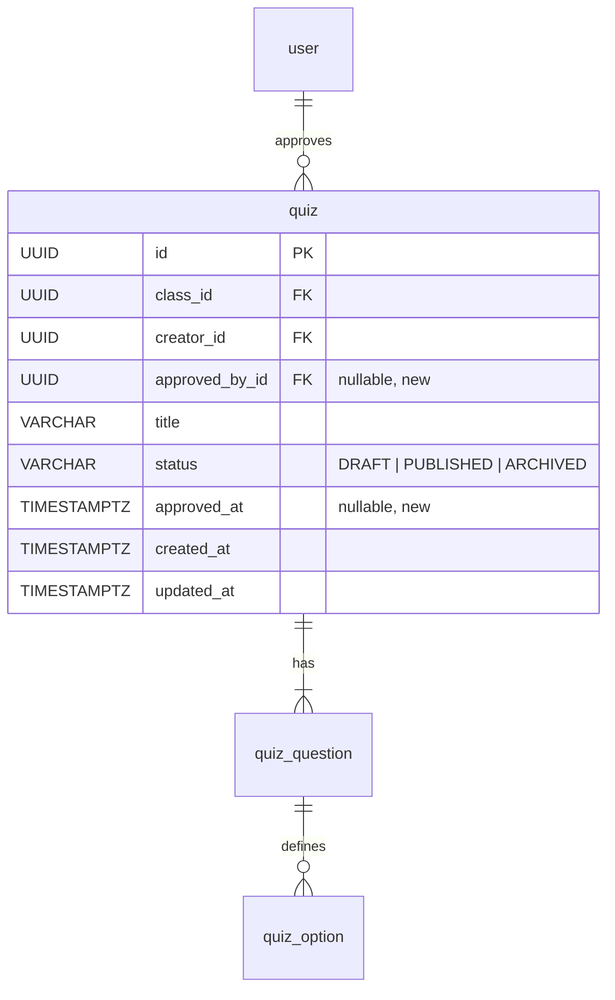

# AI-151 — Teacher Review, Approve, and Export Quiz to Excel

> **Ticket:** [AI-151](https://ai03.atlassian.net/browse/AI-151) (Epic AI-147: Quiz Generation & Assessment) | **Priority:** Medium | **Story Points:** 8 SP  
> **Assignee:** Nguyễn Chí Trung (`nguyenchitrung2702`)  
> **Sprint:** Sprint 4 — Quiz & Attendance  
> **Status:** Designed / Ready for Review  
> **Target Branch:** `features/Implementation_QuizReviewExport`  
> **Related Stories:** AI-148 (quiz schema & Excel contract), AI-149 (generate quiz from documents), AI-150 (validate generated questions), AI-152 (import quiz from teacher Excel), AI-153 (student quiz-taking), AI-154 (auto-grade quiz).

---

## 1. Purpose and Scope

AI-148 fixed the quiz data model and the Excel contract. AI-152 gave teachers a way to
get questions **in** (`POST /quizzes/import`, status `DRAFT`). AI-149/AI-150 will give
teachers questions **generated** from their documents.

Neither path ends with something a teacher can actually use. A `DRAFT` quiz today is:

- **unreadable as a work product** — the review surface is read-only, there is no edit;
- **unexportable** — `export_quiz_to_workbook()` exists and is round-trip tested, but no
  HTTP route exposes it;
- **unapprovable** — nothing records that a human accepted the questions, which AI-153
  needs before a quiz can be handed to students.

AI-151 adds the **teacher review surface's backend contract**:

1. **Quiz metadata edit** — title, description, time limit, passing score.
2. **Question authoring** — add, edit, delete a question (content, points, difficulty,
   options, accepted answers), with `order_index` kept contiguous.
3. **Per-question regeneration** — delegate to the AI-149/AI-150 generator contract.
4. **Approval with an audit trail** — who approved and when, and the `DRAFT → PUBLISHED`
   transition that students' quiz list (AI-153) reads.
5. **Excel export** — download the quiz in the AI-148 workbook shape, blocked until the
   quiz is approved.

### Out of Scope

- **Question generation itself** (AI-149) and **validation/regeneration policy** (AI-150).
  This story consumes those services behind one seam (§6) and never re-implements them.
- **Near-duplicate detection while editing.** Deleting a duplicate is the teacher's call;
  AI-150 already guards the generated draft.
- **Student delivery, timers, and grading** (AI-153, AI-154). AI-151 only guarantees that an
  approved quiz is a stable, complete, exportable artifact.
- **Structured source anchors** (`document_id`, `page`, `chunk_id`). See §10 F2.
- **Question reordering by drag-and-drop.** Not in any AC; `order_index` is maintained
  automatically (append, delete) and a reorder endpoint is deferred.

### Acceptance Criteria (Jira AI-151)

* **AC-01**: The review screen lists questions; I can edit content, change correct answers,
  add/delete questions, and regenerate one question.
* **AC-02**: Source excerpt, warnings, question counts, per-question points, and total
  points are visible.
* **AC-03**: Export is blocked until the quiz is approved.
* **AC-04**: Exported xlsx matches the teacher template and can be re-imported without errors.
* **AC-05**: Approval records who approved and when.

---

## 2. Current State (verified against `main`)

| AC | What exists today | Gap |
|---|---|---|
| AC-01 | `GET /quizzes/{quiz_id}` returns `QuizTeacherRead` (questions + options + `is_correct`). Frontend `quiz-list.tsx` renders it read-only. | No `POST`/`PATCH`/`DELETE` for questions, no regenerate. |
| AC-02 | Per-question `points`, `explanation`, `source_reference`, `difficulty` are persisted and returned. Import preview carries `warnings`. | No **total points** anywhere; `source_reference` is not rendered; the persisted quiz has no warnings channel. |
| AC-03 | `quiz.status` constrained to `DRAFT \| PUBLISHED \| ARCHIVED`. | No route assigns `PUBLISHED`, and no export route to block. |
| AC-04 | `quiz_excel.export_quiz_to_workbook()` implemented; `test_no_schema_drift_round_trip` and `test_export_reads_fill_in_answers_from_grading_config` pass. | Function is unreachable over HTTP. |
| AC-05 | — | `quiz` has no `approved_by_id` / `approved_at`; migration `0032_quiz_schema` has no such columns. |

`QuizUpdate` already exists in `app/schemas/quiz.py` and is **referenced nowhere** — it was
written for this story and is used here as-is.

---

## 3. Key Technical Decisions & Rationale

| # | Decision | Why |
|---|---|---|
| **D1** | **Approval is `status = PUBLISHED` plus two audit columns**, not a fourth status value. `quiz.status` stays `DRAFT \| PUBLISHED \| ARCHIVED`. | AI-153 already gates the student quiz list on `PUBLISHED`, and `ck_quiz_status` is a DB constraint shared by four stories. Adding `APPROVED` would force a status-table migration and a second check in every consumer. The audit trail lives in the columns, the lifecycle lives in `status`. |
| **D2** | **`status` is never writable through the generic `PATCH`.** `QuizUpdate.status` is **removed** from the request schema; transitions happen only in `POST /approve` and `POST /reopen`. | AC-05 must be an honest record. If a plain `PATCH` could set `PUBLISHED`, `approved_at` would either be a lie or need a trigger. One write path per transition keeps the audit trail truthful. |
| **D3** | **Editing is refused after approval** (`409`), and `POST /reopen` returns the quiz to `DRAFT` and clears the approval pair. | AC-03/AC-04 require the exported file to be what the approver saw. Silent post-approval edits would break that guarantee. Reopening makes the intent explicit and is visible in `updated_at`. |
| **D4** | **Export emits `export_quiz_to_workbook(quiz.questions)` verbatim**, wrapped in a `StreamingResponse` like the existing template route. | AI-148's No-Schema-Drift guarantee only holds if export and import share one generator. Any second writer risks divergence, which is exactly what `test_no_schema_drift_round_trip` guards. |
| **D5** | **Export is blocked when `status != PUBLISHED`** with `409`, not `403`. | `403` means "you may not act on this class"; `409` means "the resource is in the wrong state" — same distinction the document pipeline uses (`Only pending documents can be approved`). |
| **D6** | **Totals are computed, never stored.** `total_points`, `question_count`, and per-type counts are derived in the response schema. | A stored total is a second source of truth that drifts on every edit. `question_count` already follows this rule in `QuizSummaryRead`. |
| **D7** | **`order_index` is re-sequenced by the server on add/delete**, inside the same transaction. | Clients must not have to compute indexes, and a gap or duplicate breaks the exported row order. Add appends at `max(existing) + 1`; delete closes the gap for the affected quiz only. |
| **D8** | **Question edits are whole-question replacements**, not per-field patches. `PUT /{question_id}` takes the full `QuizQuestionCreate`. | Choice questions have cross-field invariants (option labels must be sequential `A..F`, exactly one correct option, answers must exist among options). AI-148 already encodes those in `QuizQuestionCreate.validate_question_options`; field-wise patching would need a second, weaker validator. |
| **D9** | **Regeneration goes through one narrow seam** (`quiz_generation_service.regenerate_question`) and returns the same `QuizQuestionCreate` shape the importer produces. | AC-01 depends on AI-149/AI-150, both still In Progress. Defining the seam now lets the route be written, tested with a stub, and wired to the real generator without touching the HTTP contract. |
| **D10** | **Authorization reuses `_require_class_teacher`**, unchanged, on every new route. | One authorization rule for the whole quiz module: `ADMIN`, or a `TRAINER` in `class_ids_for_trainer` (primary or co-trainer). No new role logic to keep in sync. |
| **D11** | **A quiz with zero questions cannot be approved** (`409`). | Exporting or publishing an empty quiz is never the teacher's intent, and `QuizQuestion.points > 0` means an empty quiz has `max_score = 0`, which AI-154 divides by. |

---

## 4. Data Model Changes

Migration `0039_quiz_approval` (down_revision `0038_ticket_student_seen_at`).



| Column | Type | Null | Notes |
|---|---|---|---|
| `approved_by_id` | `UUID` → `user.id` `ON DELETE RESTRICT` | yes | `NULL` while `DRAFT`; set on approve, cleared on reopen. |
| `approved_at` | `TIMESTAMPTZ` | yes | Matches `approved_by_id`: both set or both `NULL`. |

Index: `ix_quiz_approved_by` on `approved_by_id` (FK lookups; cheap, and every quiz read
joins the approver's name).

No `CHECK` constraint tying the two columns together: SQLite (the test DB) and Postgres
both accept it, but the service already writes them together, and a constraint here would
only make the reopen path more brittle. Verified by a service-level test instead.

### Model additions (`app/models/quiz.py`)

```python
approved_by_id: Mapped[uuid.UUID | None] = mapped_column(
    Uuid, ForeignKey("user.id", ondelete="RESTRICT"), nullable=True, index=True
)
approved_at: Mapped[datetime | None] = mapped_column(DateTime(timezone=True), nullable=True)
```

---

## 5. API Design

All routes mount on the existing `app/routers/quizzes/router.py`
(`prefix="/api/classes/{class_id}/quizzes"`) and every one calls
`_require_class_teacher(db, user, class_id)` first.

### 5.1 Route inventory

| Method | Path | Purpose | AC |
|---|---|---|---|
| `GET` | `/{quiz_id}` | **existing** — full quiz for review | AC-01, AC-02 |
| `PATCH` | `/{quiz_id}` | Edit quiz metadata | AC-01 |
| `POST` | `/{quiz_id}/questions` | Append a question | AC-01 |
| `PUT` | `/{quiz_id}/questions/{question_id}` | Replace one question | AC-01 |
| `DELETE` | `/{quiz_id}/questions/{question_id}` | Delete one question | AC-01 |
| `POST` | `/{quiz_id}/questions/{question_id}/regenerate` | Regenerate one question | AC-01 |
| `POST` | `/{quiz_id}/approve` | `DRAFT → PUBLISHED`, record approver | AC-03, AC-05 |
| `POST` | `/{quiz_id}/reopen` | `PUBLISHED → DRAFT`, clear approver | AC-01 |
| `GET` | `/{quiz_id}/export` | Download the AI-148 workbook | AC-03, AC-04 |
| `DELETE` | `/{quiz_id}` | Delete a `DRAFT` quiz | — (lifecycle hygiene) |

### 5.2 Metadata edit

```http
PATCH /api/classes/{class_id}/quizzes/{quiz_id}
Content-Type: application/json
Authorization: Bearer <token>
```

```json
{ "title": "Networking midterm", "description": "Chapters 1-4", "time_limit_minutes": 45, "passing_score": 60 }
```

Every field optional; omitted fields keep their value; `description: null` clears it
(matching AI-129's partial-update rule).

| Status | When | Body |
|---|---|---|
| `200` | Updated | `QuizTeacherRead` with computed totals |
| `404` | `class_id` or `quiz_id` missing, or the quiz belongs to another class | `{"detail": "Quiz not found."}` |
| `409` | Quiz is not `DRAFT` | `{"detail": "Only a draft quiz can be edited."}` |
| `422` | Validation (`title` blank after trim, `time_limit_minutes <= 0`, `passing_score < 0`) | FastAPI error envelope |

`QuizUpdate` drops its `status` field (D2).

### 5.3 Question authoring

```http
POST /api/classes/{class_id}/quizzes/{quiz_id}/questions
Content-Type: application/json
```

Body: the existing `QuizQuestionCreate` (AI-148), unchanged — `question_type`, `question`,
`points`, `difficulty`, `order_index` (**ignored, server-assigned**), `explanation`,
`rubric`, `source_reference`, `grading_config`, `options[]`, `correct_answers[]`.

| Status | When |
|---|---|
| `201` | Question appended; body is `QuizTeacherRead` with the new `total_points` |
| `409` | Quiz is not `DRAFT` |
| `422` | Any AI-148 rule fails — labels not sequential from `A`, `SINGLE_CHOICE` with ≠ 1 correct option, `FILL_IN_BLANK` with options or with neither answer nor rubric, `points <= 0` |

```http
PUT /api/classes/{class_id}/quizzes/{quiz_id}/questions/{question_id}
```

Same body and same rules. The question **and its options are replaced atomically**; `id`
and `order_index` are preserved, so a re-fetch by the UI keeps the same row identity.
`404` if the question does not belong to this quiz.

```http
DELETE /api/classes/{class_id}/quizzes/{quiz_id}/questions/{question_id}
```

Deletes the question (options cascade via `cascade="all, delete-orphan"`), then re-sequences
the remaining `order_index` values to `0..n-1`. `200` with the updated `QuizTeacherRead`.

### 5.4 Regenerate one question (AC-01)

```http
POST /api/classes/{class_id}/quizzes/{quiz_id}/questions/{question_id}/regenerate
Content-Type: application/json
```

```json
{ "instructions": "Make the distractors harder and keep it APPLY level" }
```

Body is optional (`instructions` nullable, ≤ 500 chars).

| Status | When |
|---|---|
| `200` | Replaced **in place** (same `id`, same `order_index`); returns the new `QuizTeacherRead` |
| `409` | Quiz is not `DRAFT` |
| `502` | The generator returned nothing usable or its output failed AI-148 validation — the existing question is left untouched |
| `503` | Generator is not configured (no key) or AI-149/AI-150 code is not deployed yet |

The route never persists an invalid question: the generator output runs through
`QuizQuestionCreate` validation before the transaction commits (D9).

### 5.5 Approve / reopen (AC-03, AC-05)

```http
POST /api/classes/{class_id}/quizzes/{quiz_id}/approve
```

| Status | When | Effect |
|---|---|---|
| `200` | `DRAFT` with ≥ 1 question | `status = PUBLISHED`, `approved_by_id = current user`, `approved_at = now(UTC)` |
| `404` | Quiz not found in this class | — |
| `409` | Not `DRAFT`, or has zero questions | `{"detail": "Only a draft quiz with at least one question can be approved."}` |

Idempotency: a second `approve` on a `PUBLISHED` quiz returns `409`, not `200`. Re-approving
would silently rewrite `approved_at` and destroy the record AC-05 asks for.

```http
POST /api/classes/{class_id}/quizzes/{quiz_id}/reopen
```

`PUBLISHED → DRAFT`, `approved_by_id = NULL`, `approved_at = NULL`. `409` if the quiz is not
`PUBLISHED`. Archived quizzes cannot be reopened.

### 5.6 Question counts + total points (AC-02)

`QuizTeacherRead` gains three computed fields; no storage change (D6):

```json
{
  "id": "...", "title": "Networking midterm", "status": "PUBLISHED",
  "approved_at": "2026-11-06T09:14:02Z",
  "approved_by_id": "b0c1...",
  "approved_by_name": "Nguyễn Chí Trung",
  "question_count": 12,
  "total_points": 28.5,
  "question_type_counts": { "SINGLE_CHOICE": 7, "MULTIPLE_CHOICE": 3, "FILL_IN_BLANK": 2 },
  "questions": [ ... ]
}
```

`approved_by_name` is joined and returned so the review screen can render "Approved by …"
without a second request. When `status == DRAFT` both approval fields are `null`.

### 5.7 Export (AC-03, AC-04)

```http
GET /api/classes/{class_id}/quizzes/{quiz_id}/export
Authorization: Bearer <token>
```

| Status | When |
|---|---|
| `200` | `status == PUBLISHED` — body is the workbook, `Content-Type: application/vnd.openxmlformats-officedocument.spreadsheetml.sheet`, `Content-Disposition: attachment; filename="quiz_<quiz_id>.xlsx"` |
| `409` | `status != PUBLISHED` — `{"detail": "Approve this quiz before exporting it."}` |
| `404` | Quiz not found in this class |

The filename is sanitized from the title: non-`[A-Za-z0-9._-]` characters collapse to `_`,
length capped at 60, and the quiz id is always appended so two quizzes with the same title
never collide in a downloads folder.

Round-trip contract (AC-04) is inherited, not re-implemented: the file is
`export_quiz_to_workbook(quiz.questions)` — the function `test_no_schema_drift_round_trip`
covers — so re-uploading the download to `POST /quizzes/import/preview` must return
`valid: true` with identical question specifications.

---

## 6. Regeneration Seam

AC-01's "regenerate one question" is the only part of AI-151 that cannot be finished
independently. AI-149 (generate from documents, In Progress) and AI-150 (validate and
regenerate, In Progress) own the prompt and the retry policy.

`app/services/quiz_generation_service.py` (new, added by this story as a stub with a real
signature):

```python
class QuizGenerationUnavailable(RuntimeError):
    """Raised when no generator is configured (no API key, story not deployed)."""


def regenerate_question(
    *,
    db: Session,
    question: QuizQuestion,
    instructions: str | None,
    requested_by: User,
) -> QuizQuestionCreate:
    """Generate one replacement question, preserving type, points and difficulty."""
```

Contract:

- **Input:** the current question (so the generator knows the type, bloom level, points and
  the source excerpt it was derived from) plus the teacher's optional instructions.
- **Output:** one validated `QuizQuestionCreate`. Validation is the AI-148 model, so the
  generator cannot hand back something the importer would reject.
- **Failure:** raise `QuizGenerationUnavailable` → `503`, or return output that fails
  validation → `502`. In both cases the stored question is untouched.
- **Independence:** the route is testable today with a monkeypatched stub; when AI-149/150
  land, only this function's body changes, not the HTTP contract or the frontend.

---

## 7. Flow

```mermaid
flowchart TD
    A[Any /quizzes/{id}/... route] --> B{ADMIN or trainer of this class?}
    B -- no --> B1[403]
    B -- yes --> C{Quiz exists in this class?}
    C -- no --> C1[404]
    C -- yes --> D{Which route?}

    D -- PATCH meta --> E{status == DRAFT?}
    E -- no --> E1[409 Only a draft quiz can be edited]
    E -- yes --> E2[apply partial update] --> E3[200 QuizTeacherRead]

    D -- POST/PUT/DELETE question --> F{status == DRAFT?}
    F -- no --> F1[409]
    F -- yes --> F2[validate QuizQuestionCreate] --> F3[write + resequence]
    F3 --> F4[200/201 QuizTeacherRead]

    D -- regenerate --> G{status == DRAFT?}
    G -- no --> G1[409]
    G -- yes --> G2[quiz_generation_service.regenerate_question]
    G2 --> G3{valid?}
    G3 -- unavailable --> G4[503]
    G3 -- invalid --> G5[502, original kept]
    G3 -- yes --> G6[replace in place] --> G7[200]

    D -- approve --> H{status == DRAFT and questions >= 1?}
    H -- no --> H1[409]
    H -- yes --> H2[status=PUBLISHED<br/>approved_by_id, approved_at] --> H3[200]

    D -- reopen --> I{status == PUBLISHED?}
    I -- no --> I1[409]
    I -- yes --> I2[status=DRAFT, clear approval] --> I3[200]

    D -- export --> J{status == PUBLISHED?}
    J -- no --> J1[409 Approve this quiz before exporting it]
    J -- yes --> J2[export_quiz_to_workbook] --> J3[200 xlsx stream]
```

---

## 8. Security Notes

- **Class-scoped authorization on every route**, before any read or write, through the
  existing `_require_class_teacher`. A trainer cannot review, edit, approve or export
  another trainer's quiz even with a valid `quiz_id` — the quiz is re-checked against
  `class_id` (`quiz.class_id != class_id` → `404`, never a `403` that would confirm
  existence).
- **Export is not a public URL.** It sits behind the same bearer-token dependency as every
  other route; there is no signed-URL or unauthenticated static path. This matches AI-43's
  rule that download links only work for authorized users.
- **No file content is executed on export**: the response is a generated workbook from
  stored data, not an uploaded file passed through.
- **No secret or stack trace in errors.** `502` carries the AI-148 validation messages,
  which name rows/columns only. Generator exceptions are logged server-side without the
  prompt payload.
- **Approval identity comes from the token**, never from the request body — there is no
  `approved_by` field a caller could set.

---

## 9. Verification & Test Evidence

Planned for the implementation branch (this document ships on the design branch; no code
changes here).

```bash
uv run ruff check .
uv run pytest tests/quizzes tests/test_quiz_excel.py -q
```

New router tests (`tests/quizzes/test_quiz_review_router.py`):

```text
test_patch_quiz_metadata_updates_only_sent_fields
test_patch_quiz_rejects_non_draft
test_add_question_appends_with_next_order_index
test_add_question_rejects_invalid_choice_shape
test_replace_question_preserves_id_and_order_index
test_replace_question_404_when_from_another_quiz
test_delete_question_resequences_order_index
test_regenerate_replaces_in_place
test_regenerate_returns_503_when_generator_unavailable
test_regenerate_keeps_original_on_invalid_output
test_approve_sets_approver_and_timestamp
test_approve_rejects_empty_quiz
test_approve_is_not_idempotent
test_reopen_clears_approval
test_export_blocks_unapproved_quiz
test_export_returns_ai148_workbook
test_export_reimports_without_schema_drift
test_review_routes_require_class_teacher
```

`test_export_reimports_without_schema_drift` is the AC-04 gate end to end: approve → export
→ feed the bytes to `validate_and_parse_quiz_excel` → assert `is_valid` and field equality.

Tests follow the repo's DB-free pattern (SQLite in-memory engine, `get_db` override, JWT via
`create_access_token`, monkeypatched reranker warm-up), same as
`tests/quizzes/test_quiz_import_router.py`.

---

## 10. Follow-ups

1. **F1 — `QuizSummaryRead` should carry `approved_at`.** The quiz list shows `status` only;
   once quizzes are approved the list should show who/when without expanding. Deferred to
   avoid widening the import page's payload in this story.
2. **F2 — Structured source anchors.** AC-02 asks for a "source excerpt"; today
   `QuizQuestion.source_reference` is free text written by the generator or the teacher.
   Once AI-75's citation payload is reused, add `document_id` / `page` / `chunk_id` columns
   so the review screen can render the excerpt with the same viewer as the chat citations.
3. **F3 — Warnings after import.** Import-time warnings are dropped with the preview
   response. Persisting them (e.g. `quiz.import_warnings` JSON) would let the review screen
   keep showing "duplicate question text" for an imported quiz. AI-150's low-confidence
   flags (AC-04) will need the same channel; design them together.
4. **F4 — Reorder endpoint.** `PATCH /{quiz_id}/questions/order` with a `[question_id, …]`
   array, once the frontend wants drag-and-drop.
5. **F5 — Route promotion.** AI-152's follow-up suggested moving
   `GET /quizzes/import/template` to `/quizzes/template` now that export exists. Not done
   here: import and export already share one generator, and moving the URL would break the
   import page for no functional gain.
