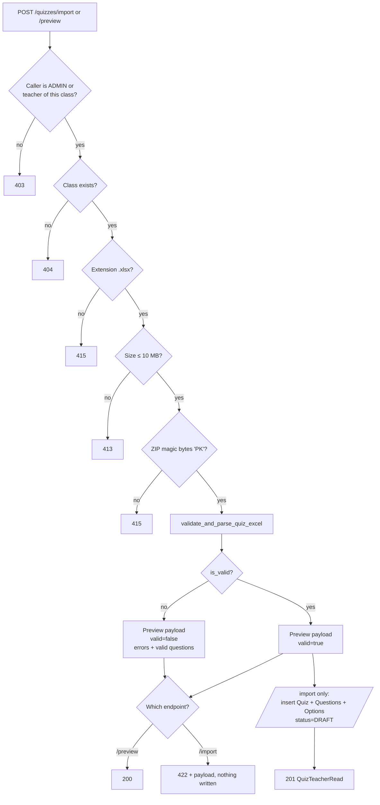
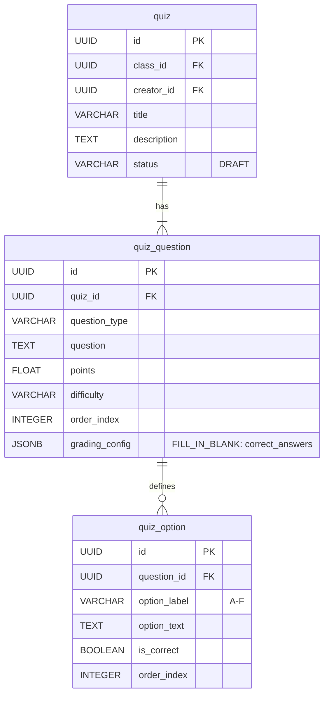

# AI-152 — Import Quiz from Teacher Excel with Row/Column Validation

> **Ticket:** [AI-152](https://ai03.atlassian.net/browse/AI-152) (Epic AI-147: Quiz Generation & Assessment) | **Priority:** Medium | **Story Points:** 8 SP  
> **Assignee:** Pham Doan Dong (`208dongpha`)  
> **Reporter:** Nguyễn Chí Trung  
> **Sprint:** Sprint 4 — Quiz & Attendance  
> **Status:** Designed / Ready for Review  
> **Target Branch:** `features/Implementation_QuizExcelImport`  
> **Related Stories:** AI-148 (quiz schema & Excel contract), AI-149 (generate quiz from documents), AI-150 (validate generated questions), AI-151 (teacher review & export to Excel), AI-153 (student quiz-taking), AI-154 (auto-grade quiz).

---

## 1. Purpose and Scope

AI-148 defines the Excel template contract and a strict validator that only produces an in-memory `list[QuizQuestionCreate]`. Teachers still have no way to turn their own question bank into a quiz.

AI-152 closes that gap by adding the **teacher-facing import surface** on top of the AI-148 contract:

1. **Preview endpoint** — parse and validate an uploaded workbook, return every parsed question plus every row/column error, without writing anything.
2. **Import endpoint** — persist a `DRAFT` quiz with its questions and options in one transaction, only when validation succeeds.
3. **Template endpoint** — serve the canonical AI-148 workbook so teachers download the exact format the importer accepts.
4. **Upload hardening** — `.xlsx`-only, 10 MB ceiling, 1,000 question-row ceiling, ZIP magic-byte check, and class-scoped authorization.
5. **Non-blocking warnings** — data-entry smells (unusually high points, duplicated question text) surface to the teacher without blocking the import.

### Out of Scope

* Question generation from documents (AI-149) and semantic duplicate/near-duplicate detection (AI-150).
* Teacher review/approval UI and Excel export (AI-151). Imported quizzes land in `DRAFT` and rely on that flow for publishing.
* Student quiz-taking (AI-153) and auto-grading (AI-154). AI-152 only guarantees the persisted data matches the AI-148 grading inputs.

### Acceptance Criteria (Jira AI-152)

* **AC-01**: Upload xlsx only, with size and row limits; file content is never executed.
* **AC-02**: Validate required columns, valid question types, non-empty prompts, at least 2 options for objective questions, correct answers inside the option list, single/multiple answer rules, and duplicate options.
* **AC-03**: Errors block import; warnings allow continuing; every error names the row and column.
* **AC-04**: Preview imported questions before approval; no silent skipping.

---

## 2. Key Technical Decisions & Rationale

| # | Decision | Why |
|---|---|---|
| **D1** | **Reuse the AI-148 validator instead of a second parser.** The router calls `validate_and_parse_quiz_excel` and never re-implements rules. | One contract for generator, exporter, importer, and grading. Prevents the template and the importer drifting apart. |
| **D2** | **Preview is advisory, import is authoritative.** `POST /import/preview` returns `200` with `valid: false` and the error list; `POST /import` returns `422` with the same payload and writes nothing. | The teacher can iterate on a broken file without creating half-valid quizzes, and the frontend can render errors and valid rows side by side. |
| **D3** | **Parsed questions are returned even when some rows fail.** `ExcelParseResult.questions` is no longer emptied on error; the import gate is `is_valid` only. | Satisfies AC-04: a 100-row file with 3 bad rows still shows the 97 good ones. Rows are never silently dropped — every rejected row produces an error with its coordinates. |
| **D4** | **Warnings are a separate channel, not errors.** `ExcelRowWarning` shares the `(row_index, column, message)` shape but does not affect `is_valid`. | AC-03 distinguishes "block" from "continue". Keeps the error list actionable instead of mixing severities. |
| **D5** | **Hard limits at the edge and in the validator.** 10 MB (`MAX_QUIZ_EXCEL_SIZE_BYTES`), 1,000 question rows (`MAX_QUIZ_EXCEL_QUESTIONS`), `.xlsx` extension, and `PK` ZIP signature. | AC-01. The router rejects early with `413/415` before `openpyxl` allocates; the validator repeats the limits so non-HTTP callers are protected too. `openpyxl` never executes macros, and `.xlsm`/`.xltm` are rejected by the extension check. |
| **D6** | **FILL_IN_BLANK answers persist under `grading_config["correct_answers"]`.** The key is now the shared constant `FILL_IN_BLANK_ANSWERS_KEY` in `quiz_excel.py`. | `quiz_question` has no `correct_answers` column (AI-148 stores type-specific grading data in the JSON `grading_config`). Before this story the exporter read a non-existent attribute, so DB-backed fill-in questions exported an empty answer cell and broke the No-Schema-Drift guarantee. |
| **D7** | **Class-scoped authorization, not a global trainer role check.** `_require_class_teacher` accepts `ADMIN`, or a `TRAINER` whose id appears in `class_ids_for_trainer` (primary slot **or** co-trainer link). | A trainer must not import into another trainer's class. Reuses `course_service` so co-trainer semantics stay in one place. |
| **D8** | **Single transaction per import.** `db.add(quiz)` + `commit()`, with `rollback()` on `SQLAlchemyError`. | A failed commit must not leave a quiz without questions, nor a dirty session for the next request. |
| **D9** | **Template stays on the import router for now.** `GET /quizzes/import/template` is served here to unblock the teacher flow. | AI-151 will re-export from the same generator; the route can be promoted to `/quizzes/template` when the export endpoint lands, without touching the contract. |

---

## 3. API Design

All routes are mounted by `app/routers/quizzes/router.py` (`prefix="/api/classes/{class_id}/quizzes/import"`), registered in `app/main.py`. Authentication uses the standard `get_current_user` dependency.

### 3.1 Preview

```http
POST /api/classes/{class_id}/quizzes/import/preview
Content-Type: multipart/form-data
Authorization: Bearer <token>
```

| Part | Type | Required | Notes |
|---|---|---|---|
| `file` | file | Yes | `.xlsx` workbook, ≤ 10 MB |

**Responses**

| Status | When | Body |
|---|---|---|
| `200` | File parsed, with or without row errors | Preview payload (below) |
| `403` | Caller is not an admin/teacher of this class | `{"detail": "Only this class' teachers can import quizzes."}` |
| `404` | `class_id` does not exist | `{"detail": "Class not found."}` |
| `413` | Payload exceeds 10 MB | `{"detail": "Excel file exceeds the 10 MB upload limit."}` |
| `415` | Wrong extension or not a ZIP/OOXML payload | `{"detail": "Upload a valid .xlsx workbook."}` |

```json
{
  "valid": false,
  "errors": [
    {
      "row_index": 4,
      "column": "Correct Answer(s)",
      "message": "Answer 'D' does not correspond to any filled option (A, B, C)."
    }
  ],
  "warnings": [
    {
      "row_index": 2,
      "column": "Points",
      "message": "Unusually high Points value '15'; confirm this is intended."
    }
  ],
  "questions": [
    {
      "question_type": "SINGLE_CHOICE",
      "question": "What does CPU stand for?",
      "points": 1.0,
      "difficulty": "REMEMBER",
      "order_index": 0,
      "explanation": null,
      "rubric": null,
      "source_reference": "Computer Architecture Chapter 1",
      "grading_config": null,
      "options": [
        { "option_label": "A", "option_text": "Central Processing Unit", "is_correct": true, "order_index": 0 },
        { "option_label": "B", "option_text": "Central Program Unit", "is_correct": false, "order_index": 1 }
      ],
      "correct_answers": []
    }
  ]
}
```

`questions` contains **every row that parsed cleanly**, even when `valid` is `false`. `order_index` is re-sequenced from `0` across the surviving rows, so a rejected row never leaves a gap.

### 3.2 Import

```http
POST /api/classes/{class_id}/quizzes/import
Content-Type: multipart/form-data
Authorization: Bearer <token>
```

| Part | Type | Required | Notes |
|---|---|---|---|
| `title` | text | Yes | 1–255 chars; trimmed, must not be blank after trim |
| `description` | text | No | Trimmed; blank becomes `null` |
| `file` | file | Yes | Same rules as preview |

**Responses**

| Status | When | Body |
|---|---|---|
| `201` | Validation passed and the quiz was persisted | `QuizTeacherRead` with nested questions/options |
| `403` / `404` / `413` / `415` | Same as preview | Same as preview |
| `422` | Validation failed (or blank title after trim) | `{"detail": <preview payload>}` — nothing is written |

Persisted state:

* `quiz.status = "DRAFT"`, `creator_id = current user`, `class_id = {class_id}`.
* Question `order_index` follows the parser order; options keep `A → F` order with `is_correct` from the answer column.
* `FILL_IN_BLANK` rows store `grading_config = {"correct_answers": [...]}` using `FILL_IN_BLANK_ANSWERS_KEY`.

### 3.3 Template

```http
GET /api/classes/{class_id}/quizzes/import/template
Authorization: Bearer <token>
```

Returns the AI-148 workbook (`quiz_template.xlsx`, sheet `Questions` + `Instructions`, sample rows, dropdown validations) with `Content-Type: application/vnd.openxmlformats-officedocument.spreadsheetml.sheet`. Same `403/404` rules as the other routes.

---

## 4. Validation & Error Contract

Rules are evaluated per row; **all** violations are collected (the teacher fixes one file, not one error per upload). Every error carries `row_index` (1-based, matching the spreadsheet) and `column` (the Excel header, or `null` for workbook-level problems).

| # | Rule | Column | Blocks? | Message (abridged) |
|---|---|---|---|---|
| V1 | File larger than 10 MB | `null` | Yes (`413` at HTTP edge) | `Excel file exceeds the 10 MB upload limit.` |
| V2 | Not a ZIP/OOXML payload | `null` | Yes (`415`) | `Upload a valid .xlsx workbook.` |
| V3 | Workbook corrupt / unreadable | `null` | Yes | `Corrupt or invalid Excel file: …` |
| V4 | Required header missing | `null` | Yes | `Missing required columns in header: …` |
| V5 | More than 1,000 question rows | `Question` | Yes | `A quiz may contain at most 1,000 question rows.` |
| V6 | No question rows at all | `Question` | Yes | `At least one question is required.` |
| V7 | `Question Type` empty / not in `SINGLE_CHOICE`, `MULTIPLE_CHOICE`, `FILL_IN_BLANK` | `Question Type` | Yes | `Invalid Question Type 'X'. Allowed: …` |
| V8 | `Question` empty | `Question` | Yes | `Question content must not be empty.` |
| V9 | `Difficulty` not in `REMEMBER`, `UNDERSTAND`, `APPLY` | `Difficulty` | Yes | `Invalid Difficulty 'X'. Allowed Bloom levels: …` |
| V10 | `Points` not numeric or `<= 0` | `Points` | Yes | `Points must be greater than 0.` |
| V11 | Option gap (e.g. C blank, D filled) | `Option D` | Yes | `Non-sequential option D detected. Previous option was left blank.` |
| V12 | Duplicate option text within a row (case-folded, whitespace-collapsed) | `Option <label>` | Yes | `Duplicate option text in this question.` |
| V13 | Choice question with fewer than 2 options | `Option A/B` | Yes | `SINGLE_CHOICE requires at least Option A and Option B.` |
| V14 | Choice question without `Correct Answer(s)` | `Correct Answer(s)` | Yes | `SINGLE_CHOICE requires specifying correct answer(s) …` |
| V15 | Answer letter not among filled options | `Correct Answer(s)` | Yes | `Answer 'F' does not correspond to any filled option (A, B, C, D).` |
| V16 | `SINGLE_CHOICE` with ≠ 1 answer | `Correct Answer(s)` | Yes | `SINGLE_CHOICE must have exactly 1 correct answer, found: A, B` |
| V17 | `FILL_IN_BLANK` with any option filled | `Option A` | Yes | `FILL_IN_BLANK questions must leave Option A through Option F blank.` |
| V18 | `FILL_IN_BLANK` without answer and without rubric | `Correct Answer(s)` | Yes | `FILL_IN_BLANK question requires a correct answer or rubric definition.` |

**Row skipping:** only completely empty rows (every mapped column blank) are skipped, and they produce no question and no message. A row with any content is always either parsed or reported — AC-04's "no silent skipping".

### Warning Catalog (non-blocking)

| # | Rule | Column | Message |
|---|---|---|---|
| W1 | `Points > 10` | `Points` | `Unusually high Points value '15'; confirm this is intended.` |
| W2 | Same normalized question text already seen in the file | `Question` | `Duplicate question text also appears on row 2.` |

Warnings are emitted only for rows that pass validation, so the warning list never points at a row the teacher must fix first.

---

## 5. Flow



---

## 6. Persistence & Round-Trip Contract



**Round trip:** `import → DB → export_quiz_to_workbook → re-import` must yield identical question specifications.

* Choice questions reconstruct `Correct Answer(s)` from `quiz_option.is_correct`.
* FILL_IN_BLANK reconstructs it from `grading_config[FILL_IN_BLANK_ANSWERS_KEY]`, falling back to `rubric` only when no answer was stored.
* The exporter reads both Pydantic DTOs (`correct_answers` attribute) and SQLAlchemy rows (`grading_config`), so the same function serves AI-151's DB-backed export.

---

## 7. Security Notes

* **No execution of file content**: `openpyxl.load_workbook(..., data_only=True)` reads cell values only; macros are never run, and `.xlsm`/`.xltm` are rejected by the extension check.
* **Bounded memory**: the router reads at most `10 MB + 1` bytes (`file.read(MAX + 1)`), so an oversized upload is never fully buffered.
* **Authorization before parsing**: the class/role check runs before any file read, so unauthorized callers cannot use the endpoint as a parser.
* **No error leakage on validation**: row errors are a stable, teacher-facing contract. Parser exceptions are reported as `Corrupt or invalid Excel file` without stack traces.

---

## 8. Verification & Test Evidence

```bash
uv run ruff check .
# All checks passed!

uv run pytest tests/test_quiz_excel.py tests/quizzes -q
# 27 passed
```

### Validator (`tests/test_quiz_excel.py`, 18 tests)

Pre-existing AI-148 rules (11): template structure, corrupt/empty file, missing headers, invalid type/Bloom level, empty question/points, non-sequential options, single-choice multi-answer, answer outside options, FILL_IN_BLANK with options, FILL_IN_BLANK without answer, no-schema-drift round trip.

Added for AI-152 (7):

```text
test_validate_rejects_duplicate_option_text
test_validate_rejects_oversized_payload
test_validate_rejects_too_many_question_rows
test_validate_requires_at_least_one_question
test_validate_warns_without_blocking_import
test_validate_keeps_valid_questions_next_to_errors
test_export_reads_fill_in_answers_from_grading_config
```

### Router (`tests/quizzes/test_quiz_import_router.py`, 9 tests)

```text
test_preview_accepts_valid_workbook
test_preview_returns_valid_questions_alongside_errors
test_import_persists_quiz_with_questions_and_options
test_import_blocks_invalid_workbook
test_import_rejects_non_xlsx_extension
test_import_rejects_xlsx_that_is_not_a_workbook
test_import_requires_class_teacher
test_import_requires_existing_class
test_template_download_returns_xlsx
```

Router tests follow the repo's DB-free pattern: SQLite in-memory engine, `get_db` dependency override, JWT from `create_access_token`, and a monkeypatched reranker warm-up — no PostgreSQL or external model needed.

---

## 9. Follow-ups

1. **Response schema**: `preview`/`import` failures currently return `error.__dict__`. Add `ExcelRowErrorRead` / `QuizImportPreviewRead` to `app/schemas/quiz.py` once the frontend contract is frozen.
2. **Route promotion**: move the template route to `/api/classes/{class_id}/quizzes/template` when AI-151 adds DB-backed export, so import and export share one URL.
3. **Semantic duplicate detection**: W2 only catches byte-identical prompts after normalization; near-duplicate detection belongs to AI-150 and should feed the same warning channel.
