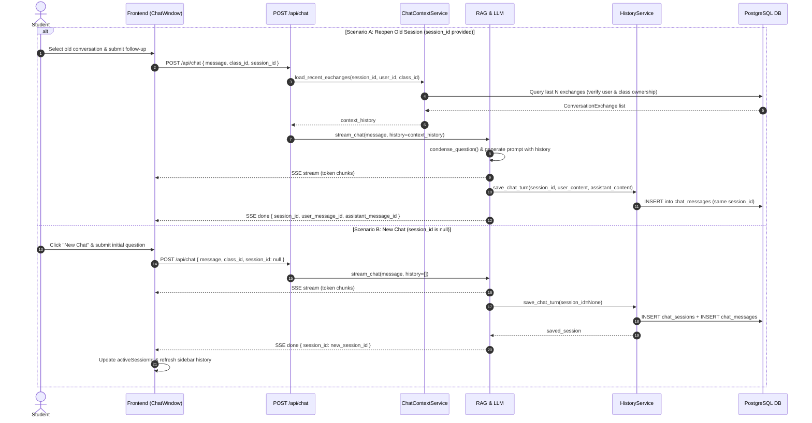

# AI-97 — Reopen an Old Conversation & Continue

> **Ticket:** [AI-97](https://ai03.atlassian.net/browse/AI-97) (Epic AI-93: Chat History & Memory) · **Priority:** High  
> **Status:** Design  
> **Related stories:** AI-95 (Chat History & Sidebar UI), AI-63 (Contextual Follow-up Questions), AI-61 (RAG Q&A Backend).

---

## 1. Purpose

Allow students to reopen a previous chat conversation from the sidebar history and continue asking follow-up questions without losing conversational context:
* **AC-01:** Opening an old session reloads that session's conversational memory (message history).
* **AC-02:** A new question correctly continues from the previous session's context (within configured context-window boundaries).
* **AC-03:** Switching to a new chat session ("New Chat") or another existing session never reuses or leaks context from previous conversations.

---

## 2. API Contract Specification

### 2.1. Request Contract — `POST /api/chat`

The request payload accepts an optional `session_id` field:

```json
{
  "message": "What was the first point you mentioned?",
  "class_id": "3fa85f64-5717-4562-b3fc-2c963f66afa6",
  "session_id": "7c9e6679-7425-40de-944b-e07fc1f90ae7"
}
```

* **`message`** *(string, required)*: User question prompt (must not be empty or whitespace).
* **`class_id`** *(UUID, required)*: Class identifier enforcing document retrieval scope and student authorization.
* **`session_id`** *(UUID, optional, nullable)*:
  * Valid `UUID`: Continues an existing chat session.
  * `null` or omitted: Starts a brand-new chat session.

### 2.2. Response Contract — Server-Sent Events (SSE)

The SSE response stream emits events in the standard format:
1. `event: progress` — Real-time progress indicators (`searching`, `reading`, `drafting`).
2. `event: token` — Text chunks of the generated answer streamed from the LLM.
3. `event: citation` — Referenced curriculum or external sources.
4. `event: done` — Turn completion metadata including the persisted `session_id`:

```json
event: done
data: {
  "source": "curriculum",
  "used_web_search": false,
  "threshold": 0.6,
  "top_score": 0.85,
  "session_id": "7c9e6679-7425-40de-944b-e07fc1f90ae7",
  "user_message_id": "11111111-2222-3333-4444-555555555555",
  "assistant_message_id": "66666666-7777-8888-9999-000000000000"
}
```

---

## 3. Session Lifecycle & Behavior



### 3.1. Security & Access Boundaries
* The router strictly verifies class membership prior to initiating the stream (`_require_class_access`).
* When `session_id` is supplied, `load_recent_exchanges()` verifies ownership by filtering on `user_id` and `class_id`. If the session does not belong to the user or class, history loading returns empty or raises an authorization error, preventing cross-tenant or cross-class data leaks.

### 3.2. Context Window & Memory Budget
* Context history is bounded by configuration parameters:
  * `CHAT_CONTEXT_EXCHANGES` (default: 5 pairs) — retains recent conversational exchanges.
  * `CHAT_CONTEXT_MAX_CHARS` (default: 6000 chars) — ensures prompt stays within token budget.
* Past turns are reformatted strictly as conversational reference; previous assistant responses are not treated as authoritative curriculum evidence.
